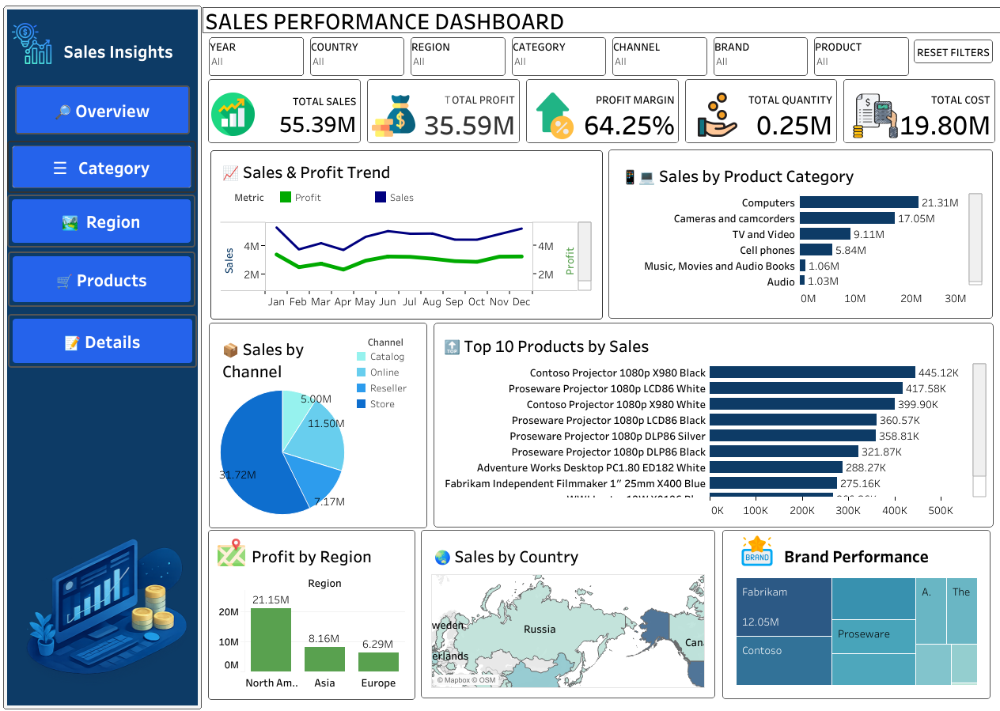

# Sales Performance Dashboard

**Tableau**

An interactive Tableau dashboard that tracks sales, cost, profit and profit margin across product categories, channels, regions, countries and brands for a 15,000-order sales dataset (February 2018 – February 2021).

## Business Problem

A sales team needs one place to see how the business is performing: how much it sells, how much profit it makes, and which categories, channels, regions and products drive the results.

## Key Findings

- **Total sales are 55.39M and total profit is 35.59M**, a profit margin of **64.25%**.
- **Computers is the top category by sales** (21.31M), ahead of Cameras and camcorders (17.05M) and TV and Video (9.11M).
- **North America is the top profit region** (21.15M), ahead of Asia (8.16M) and Europe (6.29M).
- Orders come through four channels: Store, Online, Reseller and Catalog.

> These are figures from the dataset in this repository. The dashboard shows how they change when you apply the filters.

## What the Dashboard Contains

| Area | Views |
| --- | --- |
| KPI cards | Total Sales, Total Cost, Total Profit, Total Quantity, Profit Margin |
| Trends | Sales and Profit Trend over time |
| Categories | Sales by Product Category, Profit Margin by Category |
| Channels | Sales by Channel |
| Geography | Profit by Region, Sales by Country (map) |
| Products and brands | Top 10 Products by Sales, Brand Performance |

The dashboard has seven filters (Year, Country, Region, Category, Channel, Brand, Product), a Reset Filters button, and side navigation buttons (Overview, Category, Region, Products, Details).

## Dataset

- **File:** [`data/sales_data.xlsx`](data/sales_data.xlsx) (15,000 rows, 15 columns)
- **Columns:** Order Date, Year, Order Qty, Cost of Sales, Sales, Profit, Channel, Product Name, Manufacturer, Brand Name, Product Sub Category, Product Category, Region, City, Country
- **Use:** learning and portfolio purposes.

## Requirements

- Tableau Desktop **or** the free [Tableau Public](https://public.tableau.com/app/discover) desktop app
- No packages to install. The data is packaged inside the workbook.

## How to Run

1. Download or clone this repository.
2. Open [`sales_performance_dashboard.twbx`](sales_performance_dashboard.twbx) in Tableau Desktop or Tableau Public.
3. Use the filters and page navigation to explore the dashboard.
4. To rebuild it, create a new workbook, connect to [`data/sales_data.xlsx`](data/sales_data.xlsx) and recreate the sheets listed above.

## Project Files

| File / Folder | Purpose |
| --- | --- |
| [`sales_performance_dashboard.twbx`](sales_performance_dashboard.twbx) | Tableau packaged workbook (opens with data included) |
| [`data/`](data) | Folder for the source dataset |
| [`data/sales_data.xlsx`](data/sales_data.xlsx) | Source dataset (15,000 rows) |
| [`screenshots/`](screenshots) | Folder for dashboard screenshots |
| [`screenshots/01_dashboard_overview.png`](screenshots/01_dashboard_overview.png) | Dashboard overview image |

## Screenshots

## Author

**Jagdish Sahukari** · [LinkedIn](https://www.linkedin.com/in/jagdish-sahukari-49064b312) · [GitHub](https://github.com/jagdishsahukari)
